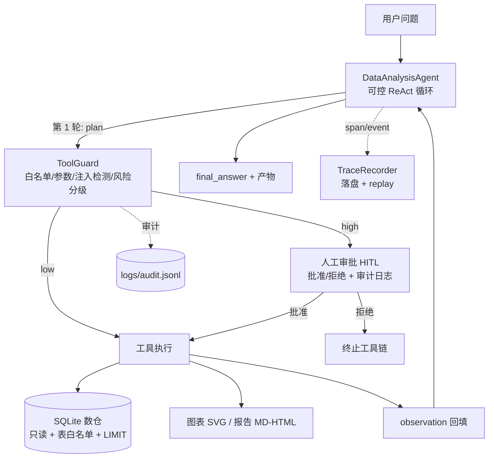

# 数析 · 智能数据分析平台（shuxi-data-agent）

> 用自然语言问业务数据：AI 先出分析计划，再调用**受控工具**做查询/指标/归因/图表/报告，高风险动作走**人工审批**，全链路 **trace_id 可回放**。

这是一个可运行、可测试的 AI 数据分析 Agent 项目，对应简历中「[数析] 智能数据分析平台」项目：把「自然语言 → 结构化分析计划 → 多工具链式调用 → 结论/图表/报告」的链路完整落地，并补上生产环境才会认真处理的三件事：**安全护栏、人在环路、可观测性**。

> 说明：本项目是简历项目的**工程化复现**，演示数据为模拟电商数仓（SQLite）；真实大模型调用通过通义千问（DashScope）OpenAI 兼容接口完成，演示/测试模式用脚本化 Mock 模型，零网络可复现。

## 核心特性

| 能力 | 实现 |
| --- | --- |
| 计划式 Agent | 第一轮先输出 2~5 步分析计划，再逐步执行；计划中的工具先过白名单 |
| 自研可控 ReAct 循环 | 不依赖 AgentExecutor 黑盒：每步可校验、可审计、可中断，支持最大步数保护 |
| 6 个受控工具 | `inspect_schema` / `query_data` / `compute_metrics` / `detect_anomaly_drivers` / `generate_chart` / `export_report` |
| 工具白名单 + 注入检测 | 工具名白名单、参数类型校验、危险指令黑名单（`import`/`exec`/`os.system`/`DROP TABLE`…） |
| Human-in-the-Loop | 计划后自动评估风险；高风险（全量导出、敏感字段）挂起等待人工批准，支持断点续跑 `resume()` |
| 三级 JSON 容错 | 直接解析 → 正则提取 JSON → 兜底文本并回灌错误重试（≤2 次） |
| 全链路 Trace | `trace_id → query → plan → LLM → 工具链 → 耗时` 结构化落盘，`--replay` 回放 |
| SQL 只读护栏 | SQLite `mode=ro`、单条 SELECT、表白名单、自动 LIMIT、危险关键字拒绝 |
| Streamlit 工作台 | 问题输入、计划/步骤展示、审批按钮、图表预览、报告下载、历史 trace 回放 |
| 可测试性 | MockProvider 剧本驱动完整流程；agent 支持注入自定义工具；172 个单元测试（1 个 pandas 可选用例跳过） |
| 渐进增强 | 核心链路（Agent/护栏/工具/数据/报告）**零第三方依赖**，只用标准库即可跑；pandas、matplotlib、streamlit 为可选增强 |

## 架构



## 快速开始

环境：Python 3.9+（建议 3.10+）。

```bash
git clone https://github.com/zz-147/shuxi-data-agent.git
cd shuxi-data-agent

python -m venv .venv
# Windows: .venv\Scripts\activate    Linux/macOS: source .venv/bin/activate
pip install -r requirements.txt
pip install -e .          # 安装 shuxi 包（之后可在任意目录 python -m shuxi）
```

> 最小运行：核心链路（Agent / 护栏 / 6 个工具 / SQLite 数据 / 报告）**不装任何第三方包也能跑**——在仓库根目录执行 `PYTHONPATH=src python -m shuxi ... --mock`（Windows PowerShell：`$env:PYTHONPATH='src'; python -m shuxi ... --mock`）即可，图表会自动降级为纯标准库 SVG 渲染。`requirements.txt` 提供的是图表（matplotlib）、Streamlit 工作台（streamlit）等可选增强能力。
>
> 国内网络提示：若 pip 直连失败，可换镜像 `pip install -r requirements.txt -i https://pypi.tuna.tsinghua.edu.cn/simple`；本仓库代码本身不依赖镜像。

### 1）离线演示（不需要 API Key）

```bash
python scripts/init_demo_data.py          # 生成演示数仓 data/demo.db
python -m shuxi "查询 2025 年 9 月华东区销售额，并和上月对比，再画趋势图" --mock
```

演示模式用 `examples/mock_transcript.json` 剧本模拟模型响应，会依次调用 `inspect_schema → compute_metrics → detect_anomaly_drivers → generate_chart`，产出图表和 trace。

### 2）接入通义千问（真实模型）

```bash
cp .env.example .env      # 填入 DASHSCOPE_API_KEY，SHUXI_PROVIDER=dashscope
python -m shuxi "查询 2025 年 9 月华东区销售额，并和上月对比"
```

### 3）Streamlit 工作台

```bash
streamlit run app.py
```

浏览器打开后：输入问题 → 查看计划与执行步骤 → 高风险操作弹审批 → 预览图表 / 下载报告 → 查看与回放 trace。

### 4）Trace 回放

```bash
python -m shuxi --list-traces
python -m shuxi --replay <trace_id>
```

## 目录结构

```
shuxi-data-agent/
├── src/shuxi/
│   ├── agent.py          # ReAct 循环 / 计划 / HITL 断点 / 结果汇总
│   ├── guard.py          # 白名单 / 参数校验 / 注入检测 / 风险分级 / 审计
│   ├── json_parser.py    # 三级容错 JSON 解析
│   ├── tools/            # 6 个受控工具 + 注册表
│   ├── store.py          # SQLite 只读查询 / schema / profile
│   ├── trace.py          # trace span/event / 落盘 / replay
│   ├── llm.py            # MockProvider + DashScope(OpenAI 兼容)
│   ├── charts.py         # matplotlib → SVG
│   └── report.py         # Markdown / 自包含 HTML 报告
├── app.py                # Streamlit 工作台
├── scripts/init_demo_data.py
├── data/                 # 演示数仓（CSV + demo.db）
├── examples/             # Mock 剧本
├── docs/                 # 架构与演示文档
└── tests/                # 单元测试
```

## 设计取舍（面试常问）

1. **为什么自研 ReAct 循环，而不是直接用 LangChain AgentExecutor？**
   AgentExecutor 把「解析 → 校验 → 审批 → 执行」包在一个黑盒里，HITL 断点续跑、风险分级审计、trace 归因都要改框架内部。这里循环只有 ~200 行，换来每步可校验、可中断、可回放；同时保留 `LLMProvider`/工具 schema 抽象，后续接 LangChain 工具或 LangGraph 节点也不难。
2. **为什么安全护栏放在工具层，而不是靠 prompt？**
   Prompt 是「请求」不是「约束」。模型可能被注入文本诱导输出危险参数，所以白名单、注入检测、SQL 只读、LIMIT 都在工具执行前硬拦截；prompt 只负责让模型少犯错。
3. **为什么需要三级 JSON 容错？**
   真实模型会输出代码块、前后解释、尾逗号。直接 `json.loads` 失败就整条链失败；三级容错 + 错误回灌重试把「格式抖动」变成可恢复错误。
4. **为什么高风险动作要人工审批？**
   全量导出、敏感字段访问的代价不可逆。把风险分级放在「计划之后、执行之前」，人工只需看一个动作的风险与参数，审批成本最低。
5. **为什么 trace 要落盘并用 trace_id 贯穿？**
   线上问题不是「结果错了」，而是「哪一步开始错」。span 树 + 事件时间线能定位是模型、工具还是数据的问题；面试时也能直接回放演示。

## 测试

```bash
python -m unittest discover -s tests -t . -v     # 172 个用例，1 个 pandas 可选用例跳过
# 或
pytest -q
```

覆盖：ReAct 全流程、JSON 三级容错、注入检测/白名单、风险分级与审批、审计日志、SQL 只读护栏、6 个工具、图表/报告产物（matplotlib 与纯标准库 SVG 两条渲染路径）、trace 落盘与回放。

## 已知限制

- 演示数仓为模拟电商数据（约 4000 行），非生产规模；SQL 引擎为 SQLite，生产可替换 MySQL/Doris。
- 指标口径只覆盖 5 个常用指标；维度下钻限 region/channel/category。
- 未实现多轮会话记忆与行级/列级权限；生产需接入统一身份与权限系统。
- `--mock` 是脚本化演示，不代表真实模型能力；真实效果依赖 `DASHSCOPE_API_KEY` 与模型版本。
- pandas / matplotlib / streamlit 为可选依赖：未安装时核心链路与测试仍可运行，图表自动降级为标准库 SVG，Streamlit 工作台不可用（CLI 不受影响）。

## License

MIT
